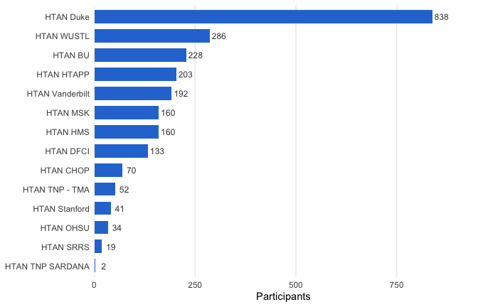
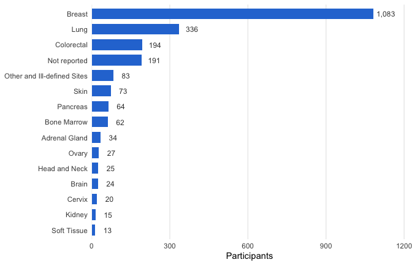
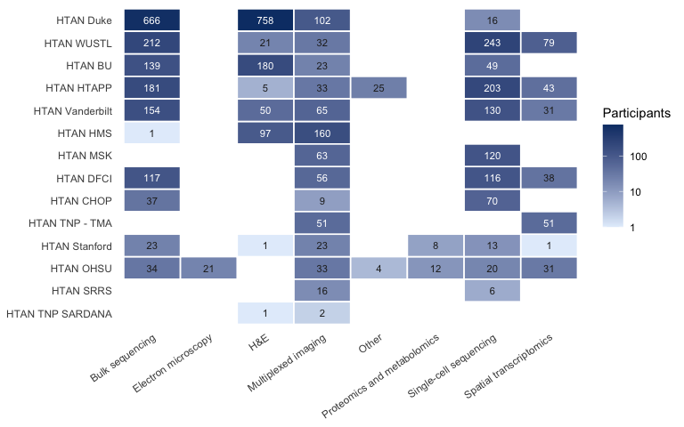
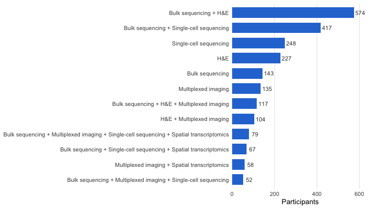
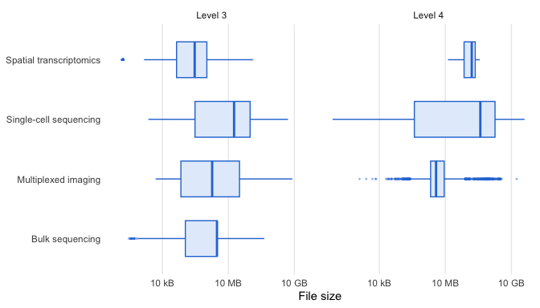
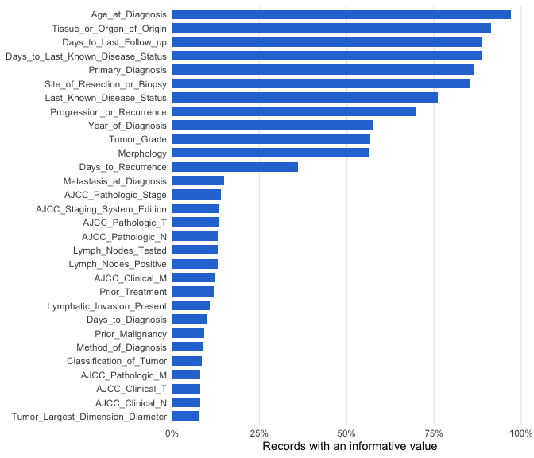
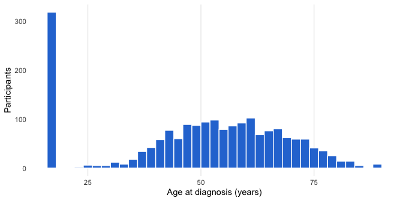

This vignette describes HTAN Phase 1 as it stands in Release 7, the final
Phase 1 release: who the participants are, where their samples came from,
which assays were run on them, at which data levels the results were
released, and how much clinical annotation comes with them. It is meant to
help you judge what HTAN can and cannot support before you plan an
analysis.

Every number, table and figure below is computed from the Release 7
metadata snapshot. The [data model vignette](data-model.html) explains the
tables used here; this vignette leans on its warnings about duplicates,
comma-separated lists and inconsistent spelling.


``` r
library(HTAN)
library(dplyr)
library(ggplot2)
con <- htan_con("r7")
```


# Building the working tables

Three tables carry most of what follows. `files` is one row per file from
`htan_files()`, with a coarse *modality* added. `file_participants` links
files to participants through `id_provenance`, one row per pair, so that
pooled files count for every participant they include. `imaging_types`
gives the imaging technology of each Level 2 image, which `Component` does
not record (every multiplexed image, H&E slide and MERFISH run is
`ImagingLevel2`).


``` r
imaging_types <- htan_tbl("imaging_level2_metadata", con) |>
    select(HTAN_Data_File_ID, Imaging_Assay_Type) |>
    collect()

modality_of <- function(assay, imaging_type) {
    case_when(
        assay %in% c("ScRNA-seq", "ScATAC-seq", "ScDNA-seq") ~
            "Single-cell sequencing",
        grepl("Visium|Xenium|GeoMx|Slide-seq", assay) |
            imaging_type == "MERFISH" | assay == "ExSeqMinimal" ~
            "Spatial transcriptomics",
        imaging_type == "H&E" ~ "H&E",
        assay %in% c("Imaging", "SRRSImaging") ~ "Multiplexed imaging",
        grepl("^Bulk|HI-C", assay) ~ "Bulk sequencing",
        assay == "ElectronMicroscopy" ~ "Electron microscopy",
        assay %in% c("MassSpectrometry", "RPPA") ~ "Proteomics and metabolomics",
        .default = "Other"
    )
}

files <- htan_files(con = con) |>
    select(HTAN_Data_File_ID, HTAN_Center, Component, assay, level,
        extension, File_Size, access, n_participants) |>
    collect() |>
    left_join(imaging_types, by = "HTAN_Data_File_ID") |>
    mutate(modality = modality_of(assay, Imaging_Assay_Type))

file_participants <- htan_tbl("id_provenance", con) |>
    distinct(HTAN_Data_File_ID, HTAN_Participant_ID) |>
    collect() |>
    inner_join(select(files, HTAN_Data_File_ID, HTAN_Center, assay, level,
        modality, Imaging_Assay_Type), by = "HTAN_Data_File_ID")

dim(files)
#> [1] 221688     11
dim(file_participants)
#> [1] 245119      7
```

The imaging type of a Level 3 or 4 imaging file is that of the Level 2
image it was computed from, so the modality above is exact for Level 2
images and approximate for derived imaging files (they fall under
"Multiplexed imaging" unless their assay says otherwise). Participant
counts below use every level.

# The release at a glance


Release 7 lists 221,688 files totalling
333.7 TB. They were derived from
10,895 assayed biospecimens and 2,416
participants. The clinical demographics table has records for
2,797 participants and the biospecimen table lists
13,095 biospecimens; both include participants and samples with
no released files, so for questions about data, count from `id_provenance`
as done here. (The DCC's 2025 description of Phase 1 counted 2,042
participants and 8,425 biospecimens, before Release 7 added data from
another 422 participants.)


``` r
size_by_tier |>
    mutate(share_of_bytes = pct(bytes / sum(bytes)), size = tb(bytes)) |>
    select(access, files, size, share_of_bytes) |>
    knitr::kable(format.args = list(big.mark = ","))
```


|access       |   files|size     |share_of_bytes |
|:------------|-------:|:--------|:--------------|
|controlled   |  42,897|241.9 TB |73%            |
|open-gc      |  24,271|38.6 TB  |12%            |
|open-synapse | 154,520|53.2 TB  |16%            |


Open files on Synapse, the processed data most analyses start from, are
70%
of the files but only
16%
of the bytes. Most of the volume is raw sequencing (controlled) and Level 2
images in the CRDC General Commons.

# Centers


``` r
centers <- file_participants |>
    group_by(HTAN_Center) |>
    summarise(participants = n_distinct(HTAN_Participant_ID)) |>
    left_join(
        files |>
            group_by(HTAN_Center) |>
            summarise(files = n(),
                size_tb = round(sum(File_Size, na.rm = TRUE) / 1e12, 2),
                assays = n_distinct(assay)),
        by = "HTAN_Center") |>
    arrange(desc(participants))
knitr::kable(centers, format.args = list(big.mark = ","))
```


|HTAN_Center      | participants|   files| size_tb| assays|
|:----------------|------------:|-------:|-------:|------:|
|HTAN Duke        |          838|   7,035|   16.11|      4|
|HTAN WUSTL       |          286|   7,176|   48.07|      8|
|HTAN BU          |          228|   5,319|   13.12|      5|
|HTAN HTAPP       |          203|  41,626|   65.27|      9|
|HTAN Vanderbilt  |          192|   3,340|   22.74|      5|
|HTAN HMS         |          160|   1,690|   20.95|      2|
|HTAN MSK         |          160|   5,381|    9.77|      2|
|HTAN DFCI        |          133|  17,560|   16.79|      3|
|HTAN CHOP        |           70|   4,739|   44.65|      4|
|HTAN TNP - TMA   |           52|   4,281|    2.18|      2|
|HTAN Stanford    |           41|   6,321|   55.40|     10|
|HTAN OHSU        |           34| 116,657|   11.50|     10|
|HTAN SRRS        |           19|     262|    0.71|      3|
|HTAN TNP SARDANA |            2|     301|    6.44|      1|


The centers differ by orders of magnitude, and which center looks largest
depends on what you count. HTAN OHSU has the most files
(116,657), 95% of them electron
microscopy, which produces one file per imaged plane or tile, but only
34 participants.
HTAN Duke has by far the most participants (838),
783 of them with a diagnosis of ductal carcinoma in situ.
File counts measure how a center packaged its data more than
how much biology it covers; participants and biospecimens are the better
measure of scope.


``` r
ggplot(centers, aes(participants, reorder(HTAN_Center, participants))) +
    geom_col(fill = blue, width = 0.7) +
    geom_text(aes(label = fmt(participants)), hjust = -0.15, size = 3.2,
        colour = "grey25") +
    scale_x_continuous(expand = expansion(mult = c(0, 0.12))) +
    labs(x = "Participants", y = NULL)
```



# Organs and cancer types

The diagnosis table records each participant's tissue or organ of origin
in ICD-O-3 site terms ("Upper-outer quadrant of breast", "Sigmoid colon").
The snapshot's `tissueOrOrganOfOrigin_to_wholeOrgan_mapping` table
collapses those to whole organs. Not every term in Release 7 is in the
mapping (for example "Upper lobe lung" and several soft-tissue sites), so
terms are matched case-insensitively, the unmapped ones are assigned by
keyword, and anything left is kept as it is.


``` r
organ_map <- htan_tbl("tissueOrOrganOfOrigin_to_wholeOrgan_mapping", con) |>
    collect() |>
    mutate(key = tolower(Tissue_or_Organ_of_Origin)) |>
    distinct(key, .keep_all = TRUE)
dx <- htan_tbl("clinical_tier1_diagnosis", con) |>
    select(HTAN_Participant_ID, HTAN_Center, Tissue_or_Organ_of_Origin,
        Primary_Diagnosis) |>
    collect() |>
    mutate(key = tolower(Tissue_or_Organ_of_Origin)) |>
    left_join(select(organ_map, key, Whole_Organ), by = "key") |>
    mutate(organ = case_when(
            !is.na(Whole_Organ) ~ Whole_Organ,
            grepl("lung", key) ~ "Lung",
            grepl("^skin", key) ~ "Skin",
            grepl("connective|soft tissue|paraspinal", key) ~ "Soft Tissue",
            grepl("bone", key) ~ "Bone",
            .default = Tissue_or_Organ_of_Origin),
        organ = if_else(tolower(organ) %in% c("not reported", "unknown",
            "unknown primary site"), "Not reported", organ))
with_files <- unique(file_participants$HTAN_Participant_ID)
organ_center <- dx |>
    filter(HTAN_Participant_ID %in% with_files) |>
    distinct(HTAN_Participant_ID, organ, HTAN_Center)
organs <- organ_center |>
    distinct(HTAN_Participant_ID, organ) |>
    count(organ, sort = TRUE)
main_center <- organ_center |>
    count(organ, HTAN_Center) |>
    group_by(organ) |>
    summarise(main_center = HTAN_Center[which.max(n)],
        main_center_share = pct(max(n) / sum(n)))
organs |>
    left_join(main_center, by = "organ") |>
    head(15)
#> # A tibble: 15 × 4
#>    organ                           n main_center     main_center_share
#>    <chr>                       <int> <chr>           <chr>            
#>  1 Breast                       1083 HTAN Duke       76%              
#>  2 Lung                          336 HTAN BU         54%              
#>  3 Colorectal                    194 HTAN HMS        52%              
#>  4 Not reported                  191 HTAN Vanderbilt 92%              
#>  5 Other and Ill-defined Sites    83 HTAN HMS        53%              
#>  6 Skin                           73 HTAN DFCI       60%              
#>  7 Pancreas                       64 HTAN WUSTL      95%              
#>  8 Bone Marrow                    62 HTAN CHOP       48%              
#>  9 Adrenal Gland                  34 HTAN HTAPP      85%              
#> 10 Ovary                          27 HTAN HTAPP      67%              
#> 11 Head and Neck                  25 HTAN WUSTL      84%              
#> 12 Brain                          24 HTAN HTAPP      83%              
#> 13 Cervix                         20 HTAN WUSTL      100%             
#> 14 Kidney                         15 HTAN WUSTL      87%              
#> 15 Soft Tissue                    13 HTAN HTAPP      92%
```


``` r
organs |>
    slice_head(n = 15) |>
    ggplot(aes(n, reorder(organ, n))) +
    geom_col(fill = blue, width = 0.7) +
    geom_text(aes(label = fmt(n)), hjust = -0.15, size = 3.2,
        colour = "grey25") +
    scale_x_continuous(expand = expansion(mult = c(0, 0.12))) +
    labs(x = "Participants", y = NULL)
```



Breast dominates, and the `main_center` column shows why: most breast
participants come from one center's cohort. Lung, colorectal, skin
(melanoma) and pancreas follow. The ranking reflects which centers enrolled
large cohorts more than the burden of each cancer. "Not reported" is
large: many participants, especially in the pre-cancer atlases, have no
usable organ in the diagnosis table, and their organ has to be read from the biospecimen
table (`Site_of_Resection_or_Biopsy`) instead. A participant with several
diagnosis records can appear under more than one organ.

The most common primary diagnoses, again among participants with data:


``` r
dx |>
    filter(HTAN_Participant_ID %in% with_files) |>
    distinct(HTAN_Participant_ID, Primary_Diagnosis) |>
    count(Primary_Diagnosis, sort = TRUE) |>
    slice_head(n = 20) |>
    knitr::kable(format.args = list(big.mark = ","))
```


|Primary_Diagnosis                                |   n|
|:------------------------------------------------|---:|
|Ductal carcinoma in situ NOS                     | 787|
|Not Reported                                     | 311|
|Adenocarcinoma NOS                               | 276|
|Carcinoma NOS                                    | 105|
|Ductal carcinoma NOS                             | 103|
|Malignant melanoma NOS                           |  90|
|Neuroblastoma NOS                                |  56|
|Squamous cell carcinoma NOS                      |  49|
|High-grade serous carcinoma                      |  43|
|Small cell neuroendocrine carcinoma              |  43|
|Pancreatobiliary-type carcinoma                  |  34|
|Infiltrating duct carcinoma NOS                  |  32|
|Adenocarcinoma pancreatobiliary type             |  28|
|Multiple myeloma                                 |  28|
|Adenocarcinoma metastatic NOS                    |  25|
|Acute lymphoblastic leukemia precursor cell type |  22|
|Melanoma NOS                                     |  20|
|Adenocarcinoma intestinal type                   |  19|
|Central neuroblastoma                            |  18|
|Glioma malignant                                 |  16|


HTAN's emphasis on transitions shows here. Ductal carcinoma in situ, a
non-invasive breast lesion, is the most common single diagnosis, and
precursor states such as familial adenomatous polyposis appear further
down the list, alongside metastatic and recurrent cancers. The `NOS` ("not otherwise
specified") terms are ICD-O-3 morphology names.

# Assays and data levels

## Which assays, at which levels


``` r
assay_levels <- files |>
    mutate(level = if_else(is.na(level), "none", paste("Level", level))) |>
    count(modality, assay, level) |>
    tidyr::pivot_wider(names_from = level, values_from = n,
        values_fill = 0) |>
    select(modality, assay, `Level 1`, `Level 2`, `Level 3`, `Level 4`,
        none) |>
    arrange(modality, assay)
knitr::kable(assay_levels, format.args = list(big.mark = ","))
```


|modality                    |assay                                          | Level 1| Level 2| Level 3| Level 4|   none|
|:---------------------------|:----------------------------------------------|-------:|-------:|-------:|-------:|------:|
|Bulk sequencing             |BulkMethylation-seq                            |      80|      51|       0|       0|      0|
|Bulk sequencing             |BulkRNA-seq                                    |   4,134|   1,922|     640|       0|      0|
|Bulk sequencing             |BulkWES                                        |   7,033|   1,613|   1,014|       0|      0|
|Bulk sequencing             |HI-C-seq                                       |      66|      34|       2|       0|      0|
|Electron microscopy         |ElectronMicroscopy                             |  74,252|  36,073|      32|      41|      0|
|H&E                         |Imaging                                        |       0|   2,332|       0|       0|      0|
|Multiplexed imaging         |Imaging                                        |      16|   6,175|   4,628|   3,539|      0|
|Multiplexed imaging         |SRRSImaging                                    |       0|     143|       0|       0|      0|
|Other                       |OtherAssay                                     |       0|       0|       0|       0|    514|
|Proteomics and metabolomics |MassSpectrometry                               |   1,187|       0|      28|      28|      0|
|Proteomics and metabolomics |RPPA                                           |       0|      26|      26|      26|      0|
|Single-cell sequencing      |ScATAC-seq                                     |   2,548|     344|   1,006|     218|      0|
|Single-cell sequencing      |ScDNA-seq                                      |   1,774|   1,271|       0|       0|      0|
|Single-cell sequencing      |ScRNA-seq                                      |  15,201|   5,755|   3,705|     857|      0|
|Spatial transcriptomics     |10XGenomicsXeniumISSExperiment                 |       0|       0|       0|       0|     33|
|Spatial transcriptomics     |10xVisiumSpatialTranscriptomics-AuxiliaryFiles |       0|       0|       0|       0|    465|
|Spatial transcriptomics     |10xVisiumSpatialTranscriptomics-RNA-seq        |     794|     223|   1,264|     175|      0|
|Spatial transcriptomics     |ExSeqMinimal                                   |       0|       0|       0|       0| 21,153|
|Spatial transcriptomics     |Imaging                                        |       0|  18,572|       0|       0|      0|
|Spatial transcriptomics     |NanoStringGeoMxDSPSpatialTranscriptomics       |     239|       0|      53|       0|      0|
|Spatial transcriptomics     |Slide-seq                                      |       7|      47|     329|       0|      0|


A few patterns matter for analysis:

- **Sequencing assays have all four levels**, but Level 1 and 2 (reads) are
  controlled, and many datasets stop at Level 3 (count matrices). Level 4
  single-cell objects exist for a subset of datasets.
- **Imaging starts at Level 2.** Raw tiles (Level 1) were rarely
  submitted; the released image is the stitched OME-TIFF. Segmentation
  (Level 3) and cell tables (Level 4) exist for a fraction of images.
- **Some assays have no levels**: Xenium experiments are single bundles,
  Visium auxiliary files and "Other Assay" files sit outside the scheme,
  and ExSeq uses a minimal metadata template.

## Who ran what

The heatmap shows how many participants each center profiled with each
modality.


``` r
heat <- file_participants |>
    distinct(HTAN_Center, modality, HTAN_Participant_ID) |>
    count(HTAN_Center, modality) |>
    mutate(HTAN_Center = factor(HTAN_Center,
        levels = rev(centers$HTAN_Center)))
ggplot(heat, aes(modality, HTAN_Center, fill = n)) +
    geom_tile(colour = "white", linewidth = 0.6) +
    geom_text(aes(label = n, colour = log10(n) > 0.55 * log10(max(n))),
        size = 3) +
    scale_fill_gradient(low = "#e3eefb", high = "#0d3d75", trans = "log10",
        name = "Participants") +
    scale_colour_manual(values = c(`TRUE` = "white", `FALSE` = "grey15"),
        guide = "none") +
    labs(x = NULL, y = NULL) +
    theme(axis.text.x = element_text(angle = 35, hjust = 1),
        panel.grid = element_blank())
```




Rows are ordered by participant count. Single-cell sequencing and
multiplexed imaging are the network's common currencies:
11 of the 14 centers have both.
Spatial transcriptomics is less widespread; 7
centers have it, led by HTAN WUSTL, HTAN TNP - TMA, HTAN HTAPP.
Electron microscopy is OHSU's alone, and proteomics and metabolomics cover
only 20 participants. The darkest tiles are bulk sequencing and H&E
at Duke: its large breast cohort was characterised mainly by bulk RNA and
exome sequencing and histology, with single-cell sequencing for only a few
participants.

## Multiplexed imaging technologies


``` r
imaging_participants <- file_participants |>
    filter(!is.na(Imaging_Assay_Type)) |>
    group_by(Imaging_Assay_Type) |>
    summarise(participants = n_distinct(HTAN_Participant_ID),
        centers = paste(sort(unique(sub("HTAN ", "", HTAN_Center))),
            collapse = ", ")) |>
    arrange(desc(participants))
imaging_files <- count(imaging_types, Imaging_Assay_Type, name = "images")
imaging_participants |>
    left_join(imaging_files, by = "Imaging_Assay_Type") |>
    select(Imaging_Assay_Type, images, participants, centers) |>
    knitr::kable(format.args = list(big.mark = ","))
```


|Imaging_Assay_Type | images| participants|centers                                                        |
|:------------------|------:|------------:|:--------------------------------------------------------------|
|H&E                |  2,332|        1,113|BU, Duke, HMS, HTAPP, Stanford, TNP SARDANA, Vanderbilt, WUSTL |
|t-CyCIF            |  1,063|          177|HMS, OHSU, TNP - TMA, TNP SARDANA                              |
|MIBI               |    300|          168|Duke, HTAPP, MSK                                               |
|MxIF               |  1,747|          131|BU, DFCI, MSK, Vanderbilt                                      |
|CODEX              |  1,415|          102|CHOP, DFCI, HTAPP, Stanford, TNP SARDANA, Vanderbilt, WUSTL    |
|CyCIF              |    717|          102|HMS, OHSU, TNP - TMA, TNP SARDANA                              |
|GeoMX-DSP          |    103|          101|OHSU, TNP - TMA, Vanderbilt                                    |
|mIHC               |    644|           78|OHSU, TNP - TMA, TNP SARDANA                                   |
|RareCyte Orion     |     75|           74|HMS                                                            |
|MERFISH            | 18,572|           47|DFCI, HTAPP                                                    |
|IMC                |    104|           27|BU, WUSTL                                                      |
|SABER              |      6|            2|TNP SARDANA                                                    |
|Not Applicable     |      1|            1|BU                                                             |


H&E is the most widely shared modality, a common reference that lets
images from different technologies be registered and compared. The
multiplexed technologies (cyclic immunofluorescence in its CyCIF, t-CyCIF
and MxIF forms, CODEX, mIHC, MIBI, IMC and Orion) measure tens of protein
markers per cell in intact tissue; their Level 4 cell tables are what
`read_htan()` turns into `SpatialExperiment` objects. MERFISH, listed under
imaging because it is image-based, measures RNA and is counted as spatial
transcriptomics above.

# Single-cell and spatial coverage

Much of HTAN's value is in participants profiled more than one way. Here
each participant is assigned the set of modalities they have data for:


``` r
combos <- file_participants |>
    filter(modality %in% c("Single-cell sequencing", "Spatial transcriptomics",
        "Multiplexed imaging", "H&E", "Bulk sequencing")) |>
    distinct(HTAN_Participant_ID, modality) |>
    group_by(HTAN_Participant_ID) |>
    summarise(combo = paste(sort(modality), collapse = " + ")) |>
    count(combo, sort = TRUE)
head(combos, 12)
#> # A tibble: 12 × 2
#>    combo                                                                       n
#>    <chr>                                                                   <int>
#>  1 Bulk sequencing + H&E                                                     574
#>  2 Bulk sequencing + Single-cell sequencing                                  417
#>  3 Single-cell sequencing                                                    248
#>  4 H&E                                                                       227
#>  5 Bulk sequencing                                                           143
#>  6 Multiplexed imaging                                                       135
#>  7 Bulk sequencing + H&E + Multiplexed imaging                               117
#>  8 H&E + Multiplexed imaging                                                 104
#>  9 Bulk sequencing + Multiplexed imaging + Single-cell sequencing + Spati…    79
#> 10 Bulk sequencing + Single-cell sequencing + Spatial transcriptomics         67
#> 11 Multiplexed imaging + Spatial transcriptomics                              58
#> 12 Bulk sequencing + Multiplexed imaging + Single-cell sequencing             52
```


``` r
combos |>
    slice_head(n = 12) |>
    ggplot(aes(n, reorder(combo, n))) +
    geom_col(fill = blue, width = 0.7) +
    geom_text(aes(label = fmt(n)), hjust = -0.15, size = 3.2,
        colour = "grey25") +
    scale_x_continuous(expand = expansion(mult = c(0, 0.12))) +
    labs(x = "Participants", y = NULL)
```




986 participants have single-cell sequencing,
274 spatial transcriptomics and 668
multiplexed imaging. 156 have both
single-cell and spatial transcriptomics, and
222 have both single-cell sequencing and
multiplexed imaging: these are the participants for which cell types
defined from dissociated cells can be located in tissue.
783 participants
(32% of those
with any of these five modalities) were profiled with only one, so
cross-modal analyses draw on a much smaller set than the headline
participant count.

# What is ready to analyse

Open Level 3 and 4 files are the starting point for most reanalyses. By
modality and file type:


``` r
files |>
    filter(access == "open-synapse", level %in% c(3, 4)) |>
    count(modality, level, extension) |>
    group_by(modality, level) |>
    slice_max(n, n = 4, with_ties = FALSE) |>
    ungroup() |>
    arrange(modality, level, desc(n)) |>
    knitr::kable(format.args = list(big.mark = ","))
```


|modality                    | level|extension |     n|
|:---------------------------|-----:|:---------|-----:|
|Bulk sequencing             |     3|.rds      |   525|
|Bulk sequencing             |     3|.vcf      |   452|
|Bulk sequencing             |     3|.seg      |   238|
|Bulk sequencing             |     3|.vcf.gz   |   228|
|Electron microscopy         |     3|.am       |    29|
|Electron microscopy         |     3|.mask     |     1|
|Electron microscopy         |     3|.model    |     1|
|Electron microscopy         |     3|.tif      |     1|
|Electron microscopy         |     4|.avi      |    31|
|Electron microscopy         |     4|.mp4      |     9|
|Electron microscopy         |     4|.mpg      |     1|
|Multiplexed imaging         |     3|.tif      | 2,857|
|Multiplexed imaging         |     3|.png      | 1,573|
|Multiplexed imaging         |     3|.tiff     |   174|
|Multiplexed imaging         |     3|.csv      |    24|
|Multiplexed imaging         |     4|.csv      | 3,520|
|Multiplexed imaging         |     4|.h5ad     |    13|
|Multiplexed imaging         |     4|.txt      |     4|
|Multiplexed imaging         |     4|          |     1|
|Proteomics and metabolomics |     3|.txt      |    33|
|Proteomics and metabolomics |     3|.csv      |    21|
|Proteomics and metabolomics |     4|.txt      |    54|
|Single-cell sequencing      |     3|.tsv.gz   | 2,158|
|Single-cell sequencing      |     3|.mtx.gz   |   946|
|Single-cell sequencing      |     3|.csv      |   861|
|Single-cell sequencing      |     3|.mtx      |   307|
|Single-cell sequencing      |     4|.rds      |   647|
|Single-cell sequencing      |     4|.csv      |   223|
|Single-cell sequencing      |     4|.txt      |    76|
|Single-cell sequencing      |     4|.h5ad     |    70|
|Spatial transcriptomics     |     3|.tsv.gz   |   542|
|Spatial transcriptomics     |     3|.mtx.gz   |   318|
|Spatial transcriptomics     |     3|.csv      |   274|
|Spatial transcriptomics     |     3|.txt      |   188|
|Spatial transcriptomics     |     4|.rds      |   132|
|Spatial transcriptomics     |     4|.h5ad     |    43|


Single-cell Level 4 objects come mostly as `.rds` (R objects, often Seurat)
and `.h5ad` (AnnData), with some delimited tables; Level 3 is count
matrices in 10x, MatrixMarket and delimited formats. Imaging Level 4 is
almost entirely CSV cell tables, and Level 3 is segmentation masks.
`read_htan()` covers the `.rds`, `.h5ad`, 10x `.h5`, Space Ranger and CSV
cases.

File sizes span several orders of magnitude, which matters when you plan
downloads:


``` r
files |>
    filter(access == "open-synapse", level %in% c(3, 4), File_Size > 0,
        modality %in% c("Single-cell sequencing", "Spatial transcriptomics",
            "Multiplexed imaging", "Bulk sequencing")) |>
    ggplot(aes(File_Size, modality)) +
    geom_boxplot(outlier.size = 0.4, outlier.alpha = 0.3, fill = "#e3eefb",
        colour = blue, width = 0.6) +
    facet_wrap(~ paste("Level", level)) +
    scale_x_log10(labels = scales::label_bytes(units = "auto_si")) +
    labs(x = "File size", y = NULL)
```




``` r
files |>
    filter(access == "open-synapse", level %in% c(3, 4), File_Size > 0,
        modality %in% c("Single-cell sequencing", "Spatial transcriptomics",
            "Multiplexed imaging", "Bulk sequencing")) |>
    group_by(modality, level) |>
    summarise(files = n(),
        median = scales::label_bytes(units = "auto_si")(median(File_Size)),
        largest = scales::label_bytes(units = "auto_si")(max(File_Size)),
        .groups = "drop")
#> # A tibble: 7 × 5
#>   modality                level files median largest
#>   <chr>                   <int> <int> <chr>  <chr>  
#> 1 Bulk sequencing             3  1656 3 MB   432 MB 
#> 2 Multiplexed imaging         3  4626 2 MB   8 GB   
#> 3 Multiplexed imaging         4  3539 4 MB   18 GB  
#> 4 Single-cell sequencing      3  4711 18 MB  5 GB   
#> 5 Single-cell sequencing      4  1075 389 MB 40 GB  
#> 6 Spatial transcriptomics     3  1646 294 kB 124 MB 
#> 7 Spatial transcriptomics     4   175 158 MB 365 MB
```

Level 3 spatial transcriptomics files are small because each Space Ranger
output is split into its pieces (barcodes, features, matrix, positions).
Level 4 single-cell objects are the largest, since many combine several
samples into one object. `htan_download()` refuses downloads above 20 GB in total unless you raise
`max_bytes`.

# Biospecimens


``` r
norm <- function(x) {
    x <- trimws(x)
    x[is.na(x) | tolower(x) %in% c("not reported", "not recorded",
        "unknown", "not applicable", "")] <- "Not reported"
    paste0(toupper(substr(x, 1, 1)), substr(x, 2, nchar(x)))
}
bios |>
    mutate(Tumor_Tissue_Type = norm(Tumor_Tissue_Type)) |>
    count(Tumor_Tissue_Type, sort = TRUE) |>
    knitr::kable(format.args = list(big.mark = ","))
```


|Tumor_Tissue_Type        |     n|
|:------------------------|-----:|
|Primary                  | 5,612|
|Metastatic               | 2,340|
|Not Otherwise Specified  | 2,259|
|Premalignant             |   894|
|Normal                   |   399|
|Atypia - hyperplasia     |   343|
|Normal adjacent          |   343|
|Not reported             |   273|
|Premalignant - in situ   |   237|
|Recurrent                |   230|
|Additional Primary       |   101|
|Post therapy neoadjuvant |    58|
|Local recurrence         |    13|
|Normal distant           |     3|


Primary tumour is the largest category (43% of
biospecimens), but metastatic, premalignant and atypical tissue together
are a large share (premalignant and atypia alone are 11%),
which is what the study of transitions needs. Normal and normal-adjacent
tissue are 6%, so comparisons against normal tissue
are possible only for some atlases.


``` r
bios |>
    mutate(Preservation_Method = norm(Preservation_Method)) |>
    count(Preservation_Method, sort = TRUE) |>
    slice_head(n = 8) |>
    knitr::kable(format.args = list(big.mark = ","))
```


|Preservation_Method                     |     n|
|:---------------------------------------|-----:|
|Formalin fixed paraffin embedded - FFPE | 6,013|
|Not reported                            | 1,926|
|Snap Frozen                             | 1,255|
|Fresh                                   | 1,081|
|OCT                                     |   915|
|Frozen                                  |   832|
|Liquid Nitrogen                         |   351|
|Negative 80 Deg C                       |   234|


Formalin-fixed paraffin-embedded (FFPE) tissue is the majority. FFPE suits
imaging and some spatial methods; fresh or frozen tissue is needed for most
single-cell sequencing. The preservation method of a biospecimen therefore
largely predicts which assays could have been run on it.

# Clinical variables

## What is recorded

Tier 1 clinical data are spread over seven tables. Their sizes, and the
number of participants each covers:


``` r
clin <- c("clinical_tier1_demographics", "clinical_tier1_diagnosis",
    "clinical_tier1_therapy", "clinical_tier1_followup",
    "clinical_tier1_exposure", "clinical_tier1_familyhistory",
    "clinical_tier1_moleculartest", "clinical_tier2")
bind_rows(lapply(clin, function(t) {
    htan_tbl(t, con) |>
        summarise(rows = n(), participants = n_distinct(HTAN_Participant_ID)) |>
        collect() |>
        mutate(table = t, .before = 1)
})) |>
    knitr::kable(format.args = list(big.mark = ","))
```


|table                        |  rows| participants|
|:----------------------------|-----:|------------:|
|clinical_tier1_demographics  | 2,805|        2,797|
|clinical_tier1_diagnosis     | 2,300|        2,273|
|clinical_tier1_therapy       | 3,337|        1,930|
|clinical_tier1_followup      | 2,167|        1,861|
|clinical_tier1_exposure      | 2,004|        2,001|
|clinical_tier1_familyhistory | 2,284|        1,932|
|clinical_tier1_moleculartest | 4,700|        1,005|
|clinical_tier2               |   359|          206|


The tier 3 tables add disease-specific fields for a few hundred
participants:


``` r
htan_tables(con) |>
    filter(grepl("tier3", name)) |>
    select(name, rows)
#> # A tibble: 5 × 2
#>   name                       rows
#>   <chr>                     <dbl>
#> 1 clinical_tier3_brain         82
#> 2 clinical_tier3_breast       129
#> 3 clinical_tier3_colorectal   304
#> 4 clinical_tier3_lung          77
#> 5 clinical_tier3_melanoma      61
```

## How complete it is

A column existing does not mean it was filled in. For each diagnosis field
this computes the share of records with an informative value: not missing,
and not "Not Reported", "unknown", "Not Applicable" or a similar code.


``` r
uninformative <- c("", "not reported", "not recorded", "unknown",
    "not applicable", "not available", "na", "unknown primary site")
completeness <- function(table) {
    x <- htan_tbl(table, con) |> collect()
    x <- x[setdiff(names(x), c("Component", "Id", "entityId", "Manifest_Id",
        "Manifest_Version", "HTAN_Center", "HTAN_Participant_ID"))]
    informative <- vapply(x, function(v) {
        v <- tolower(trimws(as.character(v)))
        mean(!is.na(v) & !v %in% uninformative)
    }, numeric(1))
    tibble::tibble(table = table, field = names(informative),
        informative = informative)
}
dx_complete <- completeness("clinical_tier1_diagnosis") |>
    arrange(desc(informative))
head(dx_complete, 10)
#> # A tibble: 10 × 3
#>    table                    field                             informative
#>    <chr>                    <chr>                                   <dbl>
#>  1 clinical_tier1_diagnosis Age_at_Diagnosis                        0.971
#>  2 clinical_tier1_diagnosis Tissue_or_Organ_of_Origin               0.915
#>  3 clinical_tier1_diagnosis Days_to_Last_Follow_up                  0.887
#>  4 clinical_tier1_diagnosis Days_to_Last_Known_Disease_Status       0.887
#>  5 clinical_tier1_diagnosis Primary_Diagnosis                       0.864
#>  6 clinical_tier1_diagnosis Site_of_Resection_or_Biopsy             0.853
#>  7 clinical_tier1_diagnosis Last_Known_Disease_Status               0.761
#>  8 clinical_tier1_diagnosis Progression_or_Recurrence               0.7  
#>  9 clinical_tier1_diagnosis Year_of_Diagnosis                       0.576
#> 10 clinical_tier1_diagnosis Tumor_Grade                             0.564
```


``` r
dx_complete |>
    slice_head(n = 30) |>
    ggplot(aes(informative, reorder(field, informative))) +
    geom_col(fill = blue, width = 0.7) +
    scale_x_continuous(labels = scales::label_percent(),
        limits = c(0, 1), expand = expansion(mult = c(0, 0.02))) +
    labs(x = "Records with an informative value", y = NULL)
```




Of the 86 diagnosis fields, 11 are informative in at least
half the records. Primary diagnosis, site, age and the main staging fields
are usable for most participants; the long tail of disease-specific fields
(Gleason patterns, neuroblastoma classifications, Breslow thickness) is
filled only where it applies, and is mostly empty overall. Before an
analysis that stratifies by a clinical variable, compute its completeness
in your subset, not in the release as a whole.

## Demographics and outcome


``` r
demo_clean <- demo |>
    filter(HTAN_Participant_ID %in% with_files) |>
    distinct(HTAN_Participant_ID, .keep_all = TRUE) |>
    mutate(across(c(Gender, Race, Ethnicity, Vital_Status), norm))
count(demo_clean, Gender, sort = TRUE)
#> # A tibble: 3 × 2
#>   Gender           n
#>   <chr>        <int>
#> 1 Female        1734
#> 2 Male           524
#> 3 Not reported    94
count(demo_clean, Vital_Status, sort = TRUE)
#> # A tibble: 3 × 2
#>   Vital_Status     n
#>   <chr>        <int>
#> 1 Alive         1389
#> 2 Dead           483
#> 3 Not reported   480
count(demo_clean, Race, sort = TRUE)
#> # A tibble: 6 × 2
#>   Race                          n
#>   <chr>                     <int>
#> 1 White                      1611
#> 2 Not reported                347
#> 3 Black or african american   316
#> 4 Asian                        53
#> 5 Other                        19
#> 6 Not allowed to collect        6
```

Most participants are female, because of the breast atlases. Vital status
is known for 80% of
participants with data, but outcome analyses also need follow-up times,
whose completeness varies by atlas; check it in your subset.

Age at diagnosis is recorded in days since birth. Two features of the
values matter before you use them. First, `0` is a placeholder, not an age
(see the [data model vignette](data-model.html#pitfalls)). Second, ages are
modified for privacy: the demographics field `Age_Is_Obfuscated` says
whether a participant's age "has been modified for compliance reasons",
and the most common value is exactly 6,573 days (18 years), which looks
like a floor applied to younger participants.


``` r
ages <- htan_tbl("clinical_tier1_diagnosis", con) |>
    select(HTAN_Participant_ID, HTAN_Center, Age_at_Diagnosis) |>
    collect() |>
    filter(HTAN_Participant_ID %in% with_files) |>
    distinct(HTAN_Participant_ID, .keep_all = TRUE) |>
    mutate(age_days = suppressWarnings(as.numeric(Age_at_Diagnosis)))
ages |>
    summarise(
        participants = n(),
        missing_or_code = sum(is.na(age_days)),
        zero = sum(age_days == 0, na.rm = TRUE),
        at_18_years = sum(age_days == 6573, na.rm = TRUE)
    )
#> # A tibble: 1 × 4
#>   participants missing_or_code  zero at_18_years
#>          <int>           <int> <int>       <int>
#> 1         2273              66   287         318
count(demo_clean, Age_Is_Obfuscated)
#> # A tibble: 3 × 2
#>   Age_Is_Obfuscated     n
#>   <chr>             <int>
#> 1 False               146
#> 2 True               1746
#> 3 <NA>                460
ages |>
    filter(age_days == 6573) |>
    count(HTAN_Center, sort = TRUE)
#> # A tibble: 10 × 2
#>    HTAN_Center          n
#>    <chr>            <int>
#>  1 HTAN HTAPP          82
#>  2 HTAN DFCI           61
#>  3 HTAN CHOP           48
#>  4 HTAN HMS            44
#>  5 HTAN WUSTL          37
#>  6 HTAN MSK            29
#>  7 HTAN Stanford        9
#>  8 HTAN BU              6
#>  9 HTAN TNP - TMA       1
#> 10 HTAN TNP SARDANA     1
```


``` r
ages |>
    filter(age_days > 0) |>
    ggplot(aes(age_days / 365.25)) +
    geom_histogram(binwidth = 2, boundary = 0, fill = blue,
        colour = "white") +
    labs(x = "Age at diagnosis (years)", y = "Participants")
```



1,920 participants have a non-zero
age, with a median of
53
years. The spike at 18 includes the CHOP pediatric participants, so HTAN's
age data cannot separate children from young adults, and every age
should be read as approximate.

# Time: longitudinal sampling

HTAN set out to sample tumours across time. The
`phase1_longitudinal_data` table puts each participant's biopsies,
diagnoses, treatments and follow-up on a single timeline (days from the
index date):


``` r
long <- htan_tbl("phase1_longitudinal_data", con) |> collect()
count(long, Event_Type, sort = TRUE)
#> # A tibble: 13 × 2
#>    Event_Type                      n
#>    <chr>                       <int>
#>  1 Biopsy or Resection          1731
#>  2 Diagnosis                    1492
#>  3 Last Followup_from_followup  1321
#>  4 Vital Status                  803
#>  5 Recurrence                    571
#>  6 Recurrence_from_followup      542
#>  7 Therapy                       265
#>  8 Molecular Test                238
#>  9 Last Follow Up                217
#> 10 Last Known Disease Status     182
#> 11 Progression_from_followup     160
#> 12 Progression                    57
#> 13 Progression Free               41
biopsies <- long |>
    filter(Event_Type == "Biopsy or Resection") |>
    group_by(HTAN_Participant_ID) |>
    summarise(timepoints = n_distinct(Start))
table(timepoints = pmin(biopsies$timepoints, 4))
#> timepoints
#>    1 
#> 1731
```


0 participants have biopsies or resections on two or more
different days (the `4` row is four or more), the material for
before-and-after comparisons. The rest were sampled once, sometimes at
several sites or as several sections, which supports comparisons across
space rather than time.

# Summary

- Release 7 covers 2,416 participants with data, dominated
  in number by breast and lung cohorts and in bytes by raw sequencing and
  images.
- Single-cell sequencing and multiplexed imaging are the most widely used
  modalities; spatial transcriptomics and cross-modal profiling cover a
  minority of participants.
- Most processed data are open, on Synapse, as `.rds`, `.h5ad`, 10x and CSV
  files that `read_htan()` can read.
- Clinical data are rich in fields but uneven in completeness; check the
  variables you need in the subset you study.

The [analysis vignette](analysis-workflow.html) takes one participant from
this atlas through download and analysis.

# Session information


``` r
sessionInfo()
#> R version 4.6.0 (2026-04-24)
#> Platform: aarch64-apple-darwin23
#> Running under: macOS Tahoe 26.7.1
#> 
#> Matrix products: default
#> BLAS:   /Library/Frameworks/R.framework/Versions/4.6/Resources/lib/libRblas.0.dylib 
#> LAPACK: /Library/Frameworks/R.framework/Versions/4.6/Resources/lib/libRlapack.dylib;  LAPACK version 3.12.1
#> 
#> locale:
#> [1] en_US.UTF-8/en_US.UTF-8/en_US.UTF-8/C/en_US.UTF-8/en_US.UTF-8
#> 
#> time zone: America/New_York
#> tzcode source: internal
#> 
#> attached base packages:
#> [1] stats4    stats     graphics  grDevices utils     datasets  methods  
#> [8] base     
#> 
#> other attached packages:
#>  [1] dplyr_1.2.1                 bluster_1.23.0             
#>  [3] scater_1.41.2               ggplot2_4.0.3              
#>  [5] scran_1.41.1                scuttle_1.23.1             
#>  [7] SpatialExperiment_1.23.0    SingleCellExperiment_1.35.2
#>  [9] SummarizedExperiment_1.43.0 Biobase_2.73.2             
#> [11] GenomicRanges_1.65.1        Seqinfo_1.3.0              
#> [13] IRanges_2.47.2              S4Vectors_0.51.6           
#> [15] BiocGenerics_0.59.12        generics_0.1.4             
#> [17] MatrixGenerics_1.25.0       matrixStats_1.5.0          
#> [19] HTAN_0.99.0                 knitr_1.51                 
#> 
#> loaded via a namespace (and not attached):
#>  [1] DBI_1.3.0                   gridExtra_2.3.1            
#>  [3] httr2_1.3.0                 testthat_3.3.2             
#>  [5] rlang_1.3.0                 magrittr_2.0.5             
#>  [7] otel_0.2.0                  compiler_4.6.0             
#>  [9] RSQLite_3.53.3              vctrs_0.7.3                
#> [11] pkgconfig_2.0.3             fastmap_1.2.0              
#> [13] dbplyr_2.6.0                magick_2.9.1               
#> [15] XVector_0.53.0              labeling_0.4.3             
#> [17] utf8_1.2.6                  ggbeeswarm_0.7.3           
#> [19] purrr_1.2.2                 bit_4.6.0                  
#> [21] xfun_0.60                   MultiAssayExperiment_1.39.0
#> [23] cachem_1.1.0                beachmat_2.29.0            
#> [25] jsonlite_2.0.0              blob_1.3.0                 
#> [27] DelayedArray_0.39.4         BiocParallel_1.46.0        
#> [29] irlba_2.3.7                 parallel_4.6.0             
#> [31] cluster_2.1.8.3             R6_2.6.1                   
#> [33] RColorBrewer_1.1-3          limma_3.69.2               
#> [35] pkgload_1.5.3               brio_1.1.5                 
#> [37] Rcpp_1.1.2                  Matrix_1.7-6               
#> [39] igraph_2.3.3                tidyselect_1.2.1           
#> [41] abind_1.4-8                 yaml_2.3.12                
#> [43] viridis_0.6.5               codetools_0.2-20           
#> [45] curl_7.1.0                  pkgbuild_1.4.8             
#> [47] lattice_0.22-9              tibble_3.3.1               
#> [49] withr_3.0.3                 S7_0.2.2                   
#> [51] evaluate_1.0.5              desc_1.4.3                 
#> [53] BiocFileCache_3.2.0         pillar_1.11.1              
#> [55] BiocManager_1.30.27         filelock_1.0.3             
#> [57] rprojroot_2.1.1             scales_1.4.0               
#> [59] glue_1.8.1                  metapod_1.21.0             
#> [61] tools_4.6.0                 BiocNeighbors_2.7.2        
#> [63] ScaledMatrix_1.21.0         locfit_1.5-9.12            
#> [65] grid_4.6.0                  tidyr_1.3.2                
#> [67] edgeR_4.11.4                duckdb_1.5.5               
#> [69] beeswarm_0.4.0              BiocSingular_1.28.0        
#> [71] vipor_0.4.7                 cli_3.6.6                  
#> [73] rsvd_1.0.5                  viridisLite_0.4.3          
#> [75] S4Arrays_1.13.0             gtable_0.3.6               
#> [77] SparseArray_1.12.2          ggrepel_0.9.8              
#> [79] dqrng_0.4.1                 rjson_0.2.23               
#> [81] farver_2.1.2                memoise_2.0.1              
#> [83] lifecycle_1.0.5             statmod_1.5.2              
#> [85] bit64_4.8.2
```
